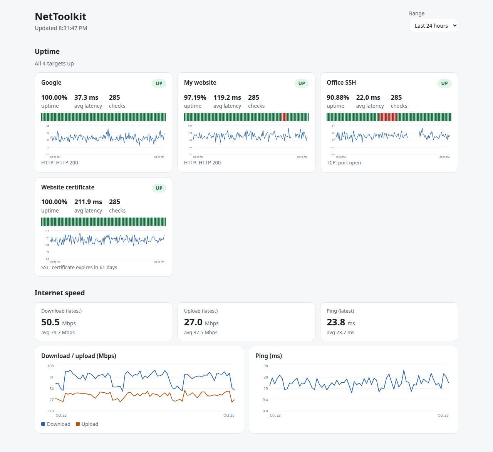

# NetToolkit

A modular networking toolkit written in Python, all behind a single `nettool`
command. No third-party dependencies (standard library only).

| Tool | What it does |
|------|--------------|
| `subnet` | Subnet calculator and splitter (IPv4/IPv6) |
| `discover` / `scan` | Ping sweep and TCP port scanner |
| `monitor` | Uptime monitor (HTTP, TCP, SSL expiry) with Telegram alerts |
| `speedlog` | Internet speed logger with history and CSV export |
| `dashboard` | Web dashboard: uptime strips, latency and speed charts |
| `logscan` | SSH auth log analyzer: brute-force sources and risky logins |
| `netauto` | Router/switch config backup with change diffs, and bulk commands (Netmiko) |
| `dns` | DNS lookups (A, AAAA, MX, NS, TXT, CNAME, PTR) and resolver speed comparison |
| `vlsm` | VLSM planner: department sizes in, a subnet plan out |
| `topology` | Network map (Graphviz) drawn from `discover` / `scan` results |

There is also a [home lab guide](docs/homelab/README.md) (Pi-hole + WireGuard in Docker).

> **Use responsibly:** only scan networks and hosts that you own or have
> explicit permission to test.

## Install

```bash
git clone https://github.com/sifatalamnayeem/nettoolkit.git
cd nettoolkit
python -m venv .venv && source .venv/bin/activate   # Windows: .venv\Scripts\activate
pip install -e ".[dev]"
```

## Usage

```bash
# Subnet calculator
nettool subnet 192.168.1.10/24
nettool subnet 192.168.1.0/24 --split 26
nettool subnet 10.0.0.0/8 --json

# Find live hosts on your LAN
nettool discover 192.168.0.0/24

# Scan ports on a host you own
nettool scan 127.0.0.1                 # common ports
nettool scan 192.168.0.1 -p 1-1024
nettool scan localhost -p 22,80,443 --all --json
```

### Uptime monitor + Telegram alerts

```bash
cp monitor.example.json monitor.json        # edit your targets
export TELEGRAM_BOT_TOKEN="123456:ABC..."   # see .env.example for setup
export TELEGRAM_CHAT_ID="123456789"

nettool alert-test                          # check that Telegram works
nettool monitor run -c monitor.json         # runs forever, Ctrl+C to stop
nettool monitor run -c monitor.json --once  # one round, exit code 1 if anything is down
nettool monitor status --hours 24           # uptime % from stored history
```

Alerts are sent only when a target changes state: it is declared **DOWN** after
`fail_threshold` consecutive failures (default 2) and you get one **RECOVERED**
message when it comes back. Without Telegram variables, alerts print to the console.

Target types in `monitor.json`:

```json
{ "type": "http", "url": "https://example.com", "expect_status": 200 }
{ "type": "tcp",  "host": "example.com", "port": 22 }
{ "type": "ssl",  "host": "example.com", "warn_days": 14 }
```

### Speed logger

```bash
nettool speedlog run                # one test (ping, download, upload) saved to the database
nettool speedlog loop --every 3600  # test every hour
nettool speedlog history -n 20
nettool speedlog export speed.csv
```

Results are stored in SQLite at `~/.nettoolkit/data.db` (override with `NETTOOL_DB`
or `--db`). The speed test uses Cloudflare's public test endpoints by default.

### Dashboard

```bash
nettool dashboard --demo      # synthetic data, ideal for a README screenshot
nettool dashboard             # your real data, http://127.0.0.1:8000
nettool dashboard --port 9000 --db /path/to/data.db
```

Run `nettool monitor run` and `nettool speedlog loop` in other terminals and the
page refreshes itself every 30 seconds. It is read-only, built with the standard
library only (a small JSON API plus plain HTML/CSS/JS, charts drawn as inline SVG),
and it supports light and dark mode. There is no login, so it binds to `127.0.0.1`
by default; keep it that way unless you put authentication in front of it.



### SSH log analyzer

```bash
nettool logscan examples/auth.sample.log --year 2026     # try it on the bundled sample
sudo nettool logscan /var/log/auth.log                   # Debian/Ubuntu
sudo nettool logscan /var/log/secure --threshold 10 --window 5
nettool logscan auth.log --json                          # for scripts
nettool logscan auth.log --ips-only                      # flagged IPs, one per line
journalctl -u ssh --no-pager | nettool logscan -         # read from stdin
```

```
Brute-force sources (>= 5 failures within 10 min):
  IP                                      FAILS   PEAK   USERS  FIRST -> LAST
  203.0.113.7                             8       8      4      2026-10-25 02:14:03 -> 2026-10-25 02:14:50

Logins that followed many failures from the same IP (review these first):
  2026-10-25 14:20:33  user 'alice' via password from 198.51.100.23 after 6 failed attempts
```

An IP is flagged when it reaches `--threshold` failed attempts inside any
`--window` minute span, so slow, spread-out failures are not reported. The
"followed many failures" section is the important one: a successful login from an
IP that had just failed repeatedly may mean a guessed password. The tool only reads
logs. It never blocks anything; review `--ips-only` output before adding firewall rules
(or use a tool such as fail2ban for automatic blocking). It understands classic syslog
and RFC 3339 timestamps, IPv4 and IPv6. Usernames are attacker-controlled text, so
control characters are stripped before printing.

### DNS lookup

```bash
nettool dns example.com                       # A record via your system resolver
nettool dns example.com -t MX -t TXT -s 1.1.1.1
nettool dns 192.0.2.5 -t PTR                  # reverse lookup from an IP
nettool dns example.com --compare             # which resolver is fastest from here?
```

Its own small DNS client (standard library only, no `dig` needed). Replies are treated as
untrusted: the transaction ID and sender are checked, forged or late packets are ignored,
compression-pointer loops are cut off, and control characters in TXT records are removed.
Large answers automatically retry over TCP. The parser is tested against a local fake DNS
server and random garbage; I could not test it against real internet servers where it was
written (the sandbox blocks DNS), so run `nettool dns example.com` once on your own network.

### VLSM planner

```bash
nettool vlsm 192.168.10.0/24 -r Sales:50 -r IT:20 -r HR:10 -r Link:2
```

```
NAME              NEED   SUBNET              MASK             HOST RANGE                        USABLE  SPARE
Sales             50     192.168.10.0/26     255.255.255.192  192.168.10.1 - 192.168.10.62      62      12
IT                20     192.168.10.64/27    255.255.255.224  192.168.10.65 - 192.168.10.94     30      10
HR                10     192.168.10.96/28    255.255.255.240  192.168.10.97 - 192.168.10.110    14      4
Link              2      192.168.10.112/30   255.255.255.252  192.168.10.113 - 192.168.10.114   2       0

192.168.10.0/24: 116 of 256 addresses used (45.3%)
Free space: 192.168.10.116/30, 192.168.10.120/29, 192.168.10.128/25
```

Biggest subnet first, so nothing overlaps and no space is lost between subnets. Host counts
include room for the network and broadcast addresses (smallest subnet is a /30).

### Network map

```bash
nettool discover 192.168.1.0/24 --json > discover.json
nettool scan 192.168.1.10 --json > scan.json          # optional, adds open ports to the map
nettool topology --discover discover.json --scan scan.json -o network.dot --png network.png
```

`--png` needs [Graphviz](https://graphviz.org/download/) installed; without it you still get
`network.dot`, which any Graphviz viewer can open. Hosts with open ports are tinted red and the
gateway (the `.1` host, or `--gateway`) is orange. Host names come from reverse DNS, which
outsiders can influence, so they are escaped before going into the file.

### Network automation (Netmiko)

```bash
pip install -e ".[automation]"          # installs Netmiko (only this feature needs it)
cp examples/inventory.example.json inventory.json
export NETTOOL_USER=admin               # credentials come from the environment (or a prompt),
export NETTOOL_PASS=...                 # never from the inventory file

nettool netauto backup -i inventory.json -o backups --show-diff
nettool netauto run -i inventory.json -c "show version" -c "show ip interface brief"

# Configuration changes: dry run first, then apply on purpose
nettool netauto run -i inventory.json --config-file change.txt            # prints what WOULD be sent
nettool netauto run -i inventory.json --config-file change.txt --apply    # asks you to type 'yes'
```

How it keeps you out of trouble:
- `backup` stores one timestamped file per change and says `NEW`, `CHANGED +3 -1`, or
  `UNCHANGED`. Lines that differ on every run (timestamps, "Building configuration") are ignored.
  Backup files are owner-only (`0600`) because configs contain secrets: keep `backups/` out of git.
- `run -c` only accepts read-only commands (`show`, `display`, `ping`, `traceroute`, `get`).
- Changes are a dry run unless you pass `--apply`, and `--apply` asks for confirmation.
- One unreachable device never stops the others; its error is reported and the exit code is 1.
- The inventory is rejected if it contains a `password` field.

The logic is tested with a fake connection; I could not test against real devices, so try it on
a lab device first (for example a Cisco Packet Tracer, GNS3 or EVE-NG node).

Example output:

```
$ nettool subnet 192.168.1.10/24
Network         192.168.1.0/24
Netmask         255.255.255.0
Wildcard        0.0.0.255
Broadcast       192.168.1.255
First host      192.168.1.1
Last host       192.168.1.254
Total addresses 256
Usable hosts    254
Private         yes
```

> Add your own screenshot here once you run it on your network.

## Project structure

```
nettoolkit/
├── nettoolkit/
│   ├── subnet/      # subnet calculator
│   ├── scanner/     # host discovery + port scanner
│   ├── monitor/     # uptime checks + state-change alerting
│   ├── alerts/      # Telegram / console notifiers
│   ├── speedlog/    # speed test
│   ├── dashboard/   # JSON API, server and static frontend
│   ├── loganalyzer/ # sshd log parser + brute-force detection
│   ├── automation/  # inventory, config backup + diff, bulk commands
│   ├── dnstool/     # DNS client and resolver comparison
│   ├── vlsm/        # VLSM subnet planner
│   ├── topology/    # Graphviz network map generator
│   ├── demo.py      # synthetic data for `dashboard --demo`
│   ├── storage.py   # SQLite history shared by monitor, speedlog, dashboard
│   └── cli.py       # `nettool` command
├── tests/
└── pyproject.toml
```

## Run the tests

```bash
pytest
```

## Roadmap

- [x] Phase 1: subnet calculator, scanner, CLI
- [x] Phase 2: uptime monitor + Telegram alerts, speed test logger
- [x] Phase 3: web dashboard
- [x] Phase 4: log analyzer, Netmiko automation, home lab docs
- [ ] Packet sniffer (`nettool sniff`): in progress, not working in this snapshot

## License

MIT
